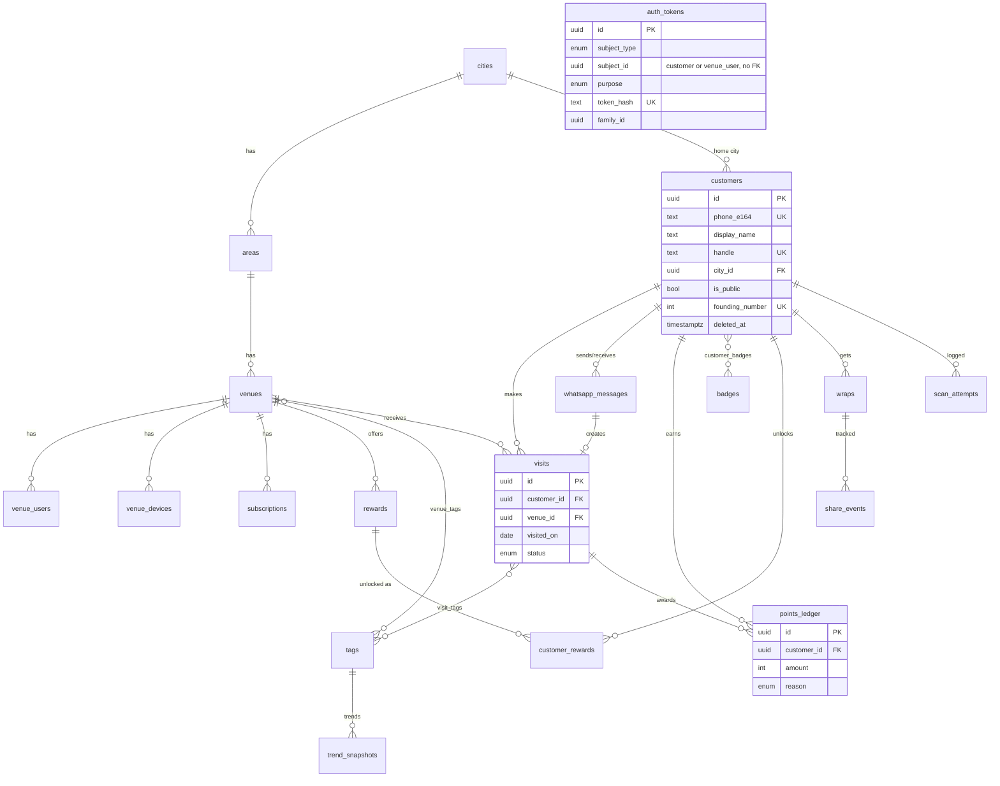

# User Module (`customers`): Plan

Part of [WORKPLAN.md](../WORKPLAN.md). The "user" in Notchs is the **customer**: a person identified by their WhatsApp number who scans QR codes at venues. Venue logins (`venue_users`, one per venue) belong to the `auth` and `venues` modules, and admins have their own table (see WORKPLAN S1). Both are out of scope here.

**Code location:** `app/modules/customers/`
**Depends on:** `core/`, `shared/`, `cities` and `areas` tables, `auth` module (tokens and cookies), `whatsapp` client.
**Used by:** `scans` pipeline (creates customers), `leaderboard`, `badges`, `rewards`, `wraps`, `venues` insights.

---

## 1. What this module owns

| Responsibility | How |
|---|---|
| Create a customer on their first WhatsApp message | `get_or_create_by_phone()`, race-safe |
| Keep the WhatsApp profile name fresh | Updated on every inbound message |
| First-time name capture ("What name should we show…?") | Bot flow + Redis conversation state |
| Display name and public name ("Riya M.") | Normalisation + computed `public_name` |
| Handle (`notchs.com/riya_m`) | Generation, validation, reserved words, change limit |
| Founding Member #N (first 500) | Assigned at creation under a lock |
| Consent (DPDP) | `consent_at` + `consent_version` set on first scan |
| Profile API | `GET/PATCH/DELETE /me`, `GET /me/visits`, `GET /u/{handle}` |
| Privacy toggle | `is_public` |
| Delete my data | Immediate anonymisation (see §6) |
| Marketing opt-out | `STOP` / `START` keywords |
| Blocking abusive users | Admin sets `is_blocked` |

Points totals, rank, badges, rewards and wraps are **not stored here**. The profile endpoint reads them from their own modules.

---

## 2. Tables

Conventions from the spec apply. Every column is `NOT NULL` unless marked nullable. `created_at` and `updated_at` (timestamptz) come from `TimestampMixin`. Times are stored in UTC.

**Source** column: `spec` = in the PDF, `new` = added by this plan, `changed` = spec field with a modified rule.

### 2.1 `customers`

| Column | Type | Null | Default | Source | Notes |
|---|---|---|---|---|---|
| `id` | uuid | | `gen_random_uuid()` | spec | PK |
| `phone_e164` | text | | | spec | Unique. `+919876543210`. Built from Meta's `wa_id`. CHECK `^\+[1-9][0-9]{7,14}$` (anonymised rows use `deleted:<id>`, see §6). |
| `wa_profile_name` | text | yes | | spec | Raw WhatsApp profile name. Refreshed on every inbound message. Never shown publicly. |
| `display_name` | text | | | spec | 1–40 chars after normalisation. Starts as the WA profile name (or `Explorer`). |
| `name_confirmed_at` | timestamptz | yes | | **new** | Set when the customer taps "Use Riya" or types a name, or edits it on the web. `NULL` = never confirmed. Tells us whether the leaderboard name is chosen or auto-filled. |
| `handle` | text | | | changed | Unique. Lowercase only, CHECK `^[a-z0-9_]{3,20}$`. Auto-generated. |
| `handle_changed_at` | timestamptz | yes | | **new** | A customer can change their handle once every 30 days, so shared profile links don't break constantly. |
| `city_id` | uuid | | | spec | FK `cities`. Taken from the venue of the first scan. |
| `is_public` | boolean | | `true` | spec | Privacy toggle (see §5). |
| `founding_number` | integer | yes | | spec | Unique. CHECK `between 1 and 500`. |
| `consent_at` | timestamptz | | | spec | When the first scan happened, and with it acceptance of the privacy policy linked in the first reply. |
| `consent_version` | text | | | **new** | Privacy-policy version accepted, e.g. `2026-10`. DPDP needs proof of *what* was agreed. |
| `preferred_language` | enum `language_code` (`en`, `hi`, `gu`) | | `en` | **new** | Cheap to add now. Bot replies stay English for MVP, but Gujarati and Hindi templates can come later without a migration. |
| `marketing_opt_out_at` | timestamptz | yes | | **new** | Set by `STOP`, cleared by `START`. No business-initiated template is sent while this is set. The MVP sends none (messages we start cost money), so this is groundwork for later. Protects the WhatsApp number's quality rating. |
| `is_blocked` | boolean | | `false` | **new** | Admin can block abusive accounts. Blocked customers get a neutral reply and no stamps. |
| `blocked_reason` | text | yes | | **new** | Internal note, admin-only. |
| `last_active_at` | timestamptz | | `now()` | spec | Updated on any inbound message or authenticated API call (at most once per minute, see §7). |
| `deleted_at` | timestamptz | yes | | spec | Set by delete-my-data. The row is anonymised at the same moment (§6). |
| `created_at`, `updated_at` | timestamptz | | `now()` | spec | Mixin |

**Indexes**

| Name | Definition | Why |
|---|---|---|
| `uq_customers_phone_e164` | unique (`phone_e164`) | Identity lookup on every inbound message |
| `uq_customers_handle` | unique (`handle`) | Public profile URL |
| `uq_customers_founding_number` | unique (`founding_number`) | Founding Member #N |
| `ix_customers_city_id` | (`city_id`) | FK index (spec rule) |
| `ix_customers_city_active` | (`city_id`, `last_active_at`) WHERE `deleted_at IS NULL` | "Active customers this month" for the Top X% calculation |

**Deliberately not stored:** total points, rank, visit count, badge count. The ledger and visits are the source of truth (spec: "Not stored as tables, on purpose"). If the profile endpoint gets slow, cache these in Redis. Don't add columns for them.

### 2.2 `auth_tokens` (owned by `auth`, listed here because customer login depends on it)

| Column | Type | Null | Source | Notes |
|---|---|---|---|---|
| `id` | uuid | | spec | PK |
| `subject_type` | enum `auth_subject_type` (`customer`, `venue_user`, `admin`) | | changed | `admin` added (WORKPLAN S1) |
| `subject_id` | uuid | | spec | No FK (spec note). |
| `purpose` | enum `auth_token_purpose` (`login_link`, `device_pairing`, `refresh`) | | spec | |
| `token_hash` | text | | spec | Unique. SHA-256 of the raw token. Raw tokens are never stored. |
| `family_id` | uuid | yes | **new** | Refresh tokens only. Every rotation keeps the same family. If an already-used refresh token is presented again (theft), revoke the whole family. |
| `expires_at` | timestamptz | | spec | 15 min for links, 30 days for refresh |
| `used_at` | timestamptz | yes | spec | Single use |
| `revoked_at` | timestamptz | yes | **new** | Logout, family revocation, account deletion. Lets us tell "used normally" apart from "killed". |
| `user_agent` | text | yes | **new** | Refresh tokens only. Shows up later as "logged in on…" in a sessions list. |
| `created_at`, `updated_at` | timestamptz | | spec | Mixin |

Indexes: unique (`token_hash`), (`subject_type`, `subject_id`), (`family_id`) WHERE `family_id IS NOT NULL`, (`expires_at`) for cleanup.

### 2.3 Enums introduced by this module

```
language_code       : en, hi, gu
auth_subject_type   : customer, venue_user, admin
auth_token_purpose  : login_link, device_pairing, refresh, set_password, password_reset
```

`set_password` and `password_reset` are used by venue users and admins, never by customers. See [auth.md](auth.md).

### 2.4 DDL (reference: Alembic migration 0001 generates the equivalent)

```sql
CREATE TYPE language_code AS ENUM ('en', 'hi', 'gu');

CREATE TABLE customers (
    id                    uuid PRIMARY KEY DEFAULT gen_random_uuid(),
    phone_e164            text        NOT NULL,
    wa_profile_name       text,
    display_name          text        NOT NULL,
    name_confirmed_at     timestamptz,
    handle                text        NOT NULL,
    handle_changed_at     timestamptz,
    city_id               uuid        NOT NULL REFERENCES cities(id),
    is_public             boolean     NOT NULL DEFAULT true,
    founding_number       integer,
    consent_at            timestamptz NOT NULL,
    consent_version       text        NOT NULL,
    preferred_language    language_code NOT NULL DEFAULT 'en',
    marketing_opt_out_at  timestamptz,
    is_blocked            boolean     NOT NULL DEFAULT false,
    blocked_reason        text,
    last_active_at        timestamptz NOT NULL DEFAULT now(),
    deleted_at            timestamptz,
    created_at            timestamptz NOT NULL DEFAULT now(),
    updated_at            timestamptz NOT NULL DEFAULT now(),

    CONSTRAINT uq_customers_phone_e164      UNIQUE (phone_e164),
    CONSTRAINT uq_customers_handle          UNIQUE (handle),
    CONSTRAINT uq_customers_founding_number UNIQUE (founding_number),
    CONSTRAINT ck_customers_handle_format   CHECK (handle ~ '^[a-z0-9_]{3,20}$'),
    CONSTRAINT ck_customers_phone_format    CHECK (phone_e164 ~ '^\+[1-9][0-9]{7,14}$' OR deleted_at IS NOT NULL),
    CONSTRAINT ck_customers_founding_range  CHECK (founding_number BETWEEN 1 AND 500),
    CONSTRAINT ck_customers_display_name    CHECK (char_length(display_name) BETWEEN 1 AND 40)
);

CREATE INDEX ix_customers_city_id     ON customers (city_id);
CREATE INDEX ix_customers_city_active ON customers (city_id, last_active_at) WHERE deleted_at IS NULL;
```

---

## 3. Where `customers` sits in the whole schema

Key columns only. Full field lists for the other tables are in the spec and in their own module plans.



`auth_tokens` links to `customers` by `(subject_type='customer', subject_id)` with no FK, as the spec intends.

---

## 4. Flows

### 4.1 First message: create the customer

Called by the scan pipeline (worker) **before** code verification. Every scan attempt can then be tied to a customer.

```
inbound message (wa_id=919876543210, profile.name="Riya Mehta", text="NOTCH KAAFI-SBR 482913")
  │
  ├─ phone = "+" + wa_id
  ├─ customers.service.get_or_create_by_phone(phone, wa_name, city_id=venue.city_id)
  │     INSERT ... ON CONFLICT (phone_e164) DO NOTHING RETURNING *
  │     if nothing returned → SELECT by phone (someone else created it a moment ago)
  │     on create:
  │        display_name    = normalize(wa_name) or "Explorer"
  │        handle          = generate_handle(display_name)        (retry on unique clash)
  │        founding_number = next_founding_number()               (NULL after 500)
  │        consent_at      = now(), consent_version = settings.PRIVACY_VERSION
  │  returns (customer, created: bool)
  │
  ├─ if customer.is_blocked → neutral reply, log scan_attempt, stop
  ├─ else: update wa_profile_name if changed, touch last_active_at
  └─ continue scan pipeline
```

If the first message is not a scan (e.g. "hi"), we still create the customer if we can resolve a city. In the MVP there is only one city, so we use the default city from settings. The bot replies with a short "scan a Notchs QR at a cafe" message.

**Founding number:** `pg_advisory_xact_lock(<const>)`, then `SELECT coalesce(max(founding_number), 0) + 1`. Assign the result if it is ≤ 500. The lock lives only for the creating transaction, so there are no gaps and no duplicates. We avoid a Postgres sequence because sequences leave gaps on rollback.

### 4.2 First-time name capture

The bot asks only after the **first ever** stamp (`created == True`):

```
Bot: What name should we show on the Ahmedabad leaderboard?
     [Use "Riya"]  [Type another name]
```

| Customer action | Result |
|---|---|
| Taps **Use "Riya"** | `name_confirmed_at = now()` |
| Taps **Type another name** | Redis `conv:{customer_id} = awaiting_name` (TTL 24h). Bot: "Type the name you'd like to show." |
| Sends text while `awaiting_name` | If it isn't a scan code or keyword: validate → `display_name = text`, `name_confirmed_at = now()`, delete conv key, reply "You'll show as Riya M." Invalid input → explain and keep waiting. |
| Ignores it | Nothing. The WA profile name stays. We don't ask again (spec: "asks once"). They can change it on the web. |

Changing the display name does **not** regenerate the handle, so shared links keep working.

### 4.3 Login link (customer side)

A customer's identity is their WhatsApp number, so the **only** way to log in is to send a message from that number. There is no email or password signup for customers.

- The link is sent in the bot's reply, so it is always inside the 24-hour customer-initiated window and costs nothing. It is sent automatically after the first stamp, and whenever the customer sends `LOGIN`.
- The website's login page has one button, **Login with WhatsApp**, which opens `https://wa.me/<number>?text=LOGIN`. The web page never takes a phone number and never sends anything itself (that would be a business-initiated message).
- `LOGIN` is rate-limited: Redis `rl:login:{customer_id}`, 3 per 15 minutes.
- `auth.service.issue_login_link(subject=customer)` creates a `login_link` token (15 min, single use) and the bot sends `https://notchs.com/login/verify?token=<token>`.
- That page does not log anyone in on load. It sends `POST /auth/customer/consume {token}`, which sets the session cookies. The frontend then redirects to `/me`. (Link previews and prefetching would otherwise burn the token.)
- Sessions last 30 days (rotating refresh token, see [auth.md §4](auth.md#4-sessions)). A new device or an expired session means sending `LOGIN` again.
- Blocked or deleted customers get no link.
- A customer who changes phone number becomes a new customer. Moving an account is out of scope for the pilot.

### 4.4 Keywords handled by this module

Matched case-insensitively on the whole message after trimming:

| Keyword | Action |
|---|---|
| `LOGIN` | Login link (via auth) |
| `WRAP` | Replies with the link to their latest wrap (replaces the monthly template message, see below) |
| `STOP` | `marketing_opt_out_at = now()`, confirm. Transactional replies to their own scans still work. |
| `START` | `marketing_opt_out_at = NULL`, confirm |
| `NAME` | Restart the name-capture prompt |

Dispatch lives in the worker's message router. The handlers live in `customers/bot.py`.

---

## 5. Names, handles and privacy rules

### Display name
- Normalise: trim, collapse internal whitespace, strip control characters and emoji, max 40 chars.
- Allowed: Unicode letters (Gujarati and Hindi names are fine), spaces, `.`, `'`, `-`.
- Must contain at least one letter. If nothing usable is left → `Explorer`.
- A profanity list check on save (simple word list in `customers/naming.py`). Admin can rename (audited).

### Public name (computed, never stored)
`public_name` = first word + space + first letter of the last word + `.`
- "Riya Mehta" → "Riya M."
- "Riya" → "Riya"
- "Riya Ben Mehta" → "Riya M."

Used everywhere a name is shown to anyone but the customer: leaderboard, feed, venue insights, public profile, cards.

### Handle
- Format `^[a-z0-9_]{3,20}$`, lowercase.
- Generated as transliterate(first name) + `_` + last initial, e.g. `riya_m`. On a clash: `riya_m2`, `riya_m3`, and so on. If too short or empty: `explorer_<4 random chars>`. Transliteration uses `unidecode`.
- Reserved, never assignable: `admin, api, app, venue, venues, me, u, w, login, logout, auth, settings, help, support, about, privacy, terms, leaderboard, trends, feed, notchs, deleted`, plus anything starting with `deleted_`.
- Customer edits: at most once per 30 days (`handle_changed_at`). Error code `customers.handle_change_too_soon` with the next allowed date.

### Privacy (`is_public = false`)

| Surface | Public customer | Private customer |
|---|---|---|
| Own profile, own rank | ✓ | ✓ |
| City and area leaderboards | Shown as "Riya M." | Still ranked (so everyone's rank stays honest), shown as **"Private explorer"** |
| `GET /u/{handle}` | Profile | 404 |
| Live feed | Shown | Not shown |
| Venue insights, regulars list | "Riya M." | "Private customer" |
| Notch card links | Work | Still work: the customer chose to share that card |

---

## 6. Delete my data

**Proposal: anonymise immediately, instead of a delayed hard delete.** This changes the spec's `cleanup` job, so the team needs to sign off (decision D1).

Why: `visits`, `points_ledger` and `customer_badges` drive venue insights, venue billing and badge rarity counts. A hard delete would silently change venues' historical numbers. Once the row holds no phone or name, the remaining data is no longer personal data.

`DELETE /me` runs in **one transaction**:

| Data | Action |
|---|---|
| `customers` | `phone_e164 = 'deleted:' + id`, `wa_profile_name = NULL`, `display_name = 'Deleted user'`, `handle = 'deleted_' + first 8 of id`, `is_public = false`, `deleted_at = now()` |
| `auth_tokens` | Delete all for this subject |
| `wraps`, `share_events` | Delete (`wraps.data` contains the name) |
| `whatsapp_messages` | Set `phone_e164 = 'deleted'`, `payload = '{}'`, `customer_id = NULL` |
| `scan_attempts` | `customer_id = NULL` |
| `customer_rewards` (unlocked) | Mark `expired` |
| `visits`, `points_ledger`, `customer_badges` | Keep (anonymous now) |
| `audit_logs` | Insert `customer.deleted` (IDs only, as the spec requires) |

After commit: remove the customer from all Redis leaderboards and delete their `conv:` and `rl:` keys. Their access cookie keeps working for up to 15 minutes, but `current_customer` rejects deleted customers, so it is useless right away.

The phone number is free again. If the same number scans later, it becomes a **new** customer.

---

## 7. API

All routes are under `/api/v1`. Errors use the shape `{"error": {"code", "message"}}`.

| Method | Path | Auth | Request | Response | Notes |
|---|---|---|---|---|---|
| GET | `/me` | customer | – | `MeOut` | Profile + summary (points, ranks, places, badges count) pulled from other modules' services |
| PATCH | `/me` | customer | `MePatch` | `MeOut` | Any subset of `display_name`, `handle`, `is_public`. Audited. |
| DELETE | `/me` | customer | `{"confirm": "DELETE"}` | 204 | §6. Clears cookies. Audited. |
| GET | `/me/handle-availability?handle=` | customer | – | `{available, reason?}` | For the edit form. Rate-limited. |
| GET | `/me/visits` | customer | `?cursor=&limit=` | `Page[VisitOut]` | Reads `visits` via the scans repository. Newest first. |
| GET | `/u/{handle}` | public | – | `PublicProfileOut` | 404 if private, deleted or blocked. Rate-limited per IP. |

`/me/badges`, `/me/rewards` and `/me/wraps` belong to their own modules and are mounted under `/me` there.

**Schemas (Pydantic v2)**

```python
class MeOut(BaseModel):
    id: UUID
    display_name: str
    public_name: str
    handle: str
    is_public: bool
    name_confirmed: bool
    founding_number: int | None
    city: CityOut                    # {id, name, slug}
    member_since: datetime
    handle_change_available_at: datetime | None
    marketing_opted_out: bool
    stats: CustomerStatsOut          # points_total, points_month, city_rank_month,
                                     # city_rank_all_time, top_percent, places_visited, badges_count

class MePatch(BaseModel):
    display_name: str | None = None  # validated by naming.normalize_display_name
    handle: str | None = None        # validated by naming.validate_handle
    is_public: bool | None = None

class PublicProfileOut(BaseModel):
    public_name: str
    handle: str
    founding_number: int | None
    city: CityOut
    member_since: datetime
    stats: PublicStatsOut            # points_total, city_rank_month, places_visited
    badges: list[BadgeSummaryOut]    # earned only

class VisitOut(BaseModel):
    id: UUID
    venue: VenueSummaryOut           # name, area, logo_url
    visited_on: date
    is_first_visit: bool
    points: int
    tried: list[str]                 # tag names from visit_tags
```

Phone numbers never appear in any response, not even `/me`. The customer knows their own number.

**Dependency `current_customer`** (in `shared/deps.py`): reads the customer access cookie, verifies the JWT (`sub` = customer id, `typ = "customer"`), loads the row, and rejects with 401 if missing or deleted, 403 if blocked. It touches `last_active_at` if more than 60 s have passed (Redis `act:{id}` key with 60 s TTL), so we don't write on every request.

**Cookie naming detail:** the spec names the cookies `nx_customer` and `nx_venue`, but each app needs **two** cookies. Proposal: `nx_customer_at` (access, `Path=/`) and `nx_customer_rt` (refresh, `Path=/api/v1/auth`), and the same pattern for venue. The refresh token is then only sent to the refresh endpoint.

**Error codes**

| Code | HTTP | When |
|---|---|---|
| `customers.not_found` | 404 | Unknown, private or deleted handle |
| `customers.display_name_invalid` | 422 | Fails normalisation, length or profanity check |
| `customers.handle_invalid` | 422 | Format or reserved word |
| `customers.handle_taken` | 409 | Unique clash |
| `customers.handle_change_too_soon` | 409 | Inside the 30-day window |
| `customers.blocked` | 403 | Blocked account |

**Audit actions:** `customer.profile_updated` (changes = changed fields only), `customer.deleted`, `customer.blocked`, `customer.unblocked`, `customer.renamed_by_admin`. Login events are recorded by `auth`.

---

## 8. Files

```
app/modules/customers/
    __init__.py
    models.py      # Customer (+ LanguageCode enum)
    schemas.py     # MeOut, MePatch, PublicProfileOut, VisitOut, CustomerStatsOut, ...
    naming.py      # normalize_display_name, public_name, generate_handle_base,
                   # validate_handle, RESERVED_HANDLES, profanity check (pure functions)
    service.py     # get_or_create_by_phone, next_founding_number, touch_activity,
                   # confirm_name, update_profile, delete_customer, set_marketing_opt_out,
                   # block/unblock, get_public_profile
    bot.py         # name-capture conversation + LOGIN/WRAP/STOP/START/NAME handlers
    router.py      # /me, /me/visits, /me/handle-availability, /u/{handle}
```

No `repository.py`: `BaseRepository` covers the queries. Add one only if a complex query appears.

Redis keys used by this module:

| Key | TTL | Purpose |
|---|---|---|
| `conv:{customer_id}` | 24 h | Conversation state (`awaiting_name`) |
| `rl:login:{customer_id}` | 15 min | LOGIN rate limit |
| `act:{customer_id}` | 60 s | Throttle `last_active_at` writes |
| `rl:handle:{customer_id}` | 1 min | Handle availability checks |

---

## 9. Tests

**Unit (`tests/unit/customers/`)**: pure functions, no DB.
- `normalize_display_name`: emoji, extra spaces, Gujarati script, empty input, 41 chars, only symbols → `Explorer`.
- `public_name`: one, two and three words.
- `generate_handle_base` and `validate_handle`: transliteration, reserved words, `deleted_` prefix, length bounds.
- Keyword matching: `login`, ` LOGIN `, `Login please` (should *not* match).

**Integration (`tests/integration/customers/`)**: real Postgres schema, see WORKPLAN §0.8.
- `get_or_create_by_phone` called concurrently 10× for the same phone → 1 row.
- Founding numbers: 20 concurrent creates → numbers 1–20, no gaps or duplicates. Customer 501 → `NULL`.
- Handle clash: two "Riya Mehta" → `riya_m`, `riya_m2`.
- `PATCH /me`: rename, handle change, second handle change within 30 days → 409, reserved handle → 422.
- Privacy: private customer → `/u/{handle}` 404, leaderboard shows "Private explorer".
- `DELETE /me`: every row in §6 is changed as specified, tokens gone, same phone can register again as a new customer.
- Blocked customer: `/me` → 403, scan → neutral reply, no visit.
- Name capture: tap Use name / type name / ignore paths via `/dev/simulate-inbound`.
- `STOP` sets the opt-out and `START` clears it. `WRAP` returns the latest wrap link, and a customer with no wrap yet gets a friendly reply.
- `LOGIN` link: consumed once through `POST /auth/customer/consume`, a second use and an expired token fail, the 4th request in 15 minutes is rate-limited, blocked and deleted customers get no link.

---

## 10. Tasks (in order)

| # | Task | Size | Depends on |
|---|---|---|---|
| C1 | Agree on new fields and decisions D1–D3 (below) | S | – |
| C2 | `Customer` model + enums, included in migration 0001. Try it in your `dev_<name>` schema. | S | WORKPLAN 1.3, 1.5 |
| C3 | `naming.py` + unit tests | M | – (can start day 1) |
| C4 | `service.get_or_create_by_phone` + founding number + concurrency tests | M | C2, C3 |
| C5 | `current_customer` dependency + activity throttle | S | auth 1.13 |
| C6 | `GET/PATCH /me`, handle availability, schemas | M | C4, C5 |
| C7 | `GET /u/{handle}`, `GET /me/visits` | S | C6, visits table |
| C8 | `bot.py`: name capture, LOGIN, WRAP, STOP/START/NAME | M | C4, WhatsApp client, worker |
| C9 | `DELETE /me` anonymisation + tests | M | C6; touches wraps, messages, rewards tables |
| C10 | Admin: block/unblock, rename customer | S | C6, admin auth |
| C11 | Seed: 3 test customers on the shared DB (upsert by phone, numbers in the `+91000000000x` range so they never collide with real numbers) | S | C4 |
| C12 | `stats` in `MeOut` wired to points and leaderboard | S | Phase 2 points/leaderboard |

S ≈ half a day to a day, M ≈ 1–3 days.

---

## 11. Decisions needed

| # | Question | Proposal |
|---|---|---|
| D1 | Delete my data: hard delete later or anonymise now? | Anonymise immediately (§6). The spec's `cleanup` job then no longer purges customers. |
| D2 | Private customers on leaderboards: hidden entirely or "Private explorer"? | "Private explorer". Ranks stay honest and private users still see their own rank. |
| D3 | Handle change limit | Once per 30 days |
| D4 | First message without a scan: create the customer or not? | Create (single city in MVP). It lets `LOGIN` work before a first scan. |
| D5 | Should a deleted number scanning again get a new founding number if any are left? | No. Founding numbers are only assigned to customers among the first 500 created, and deleted rows keep theirs. |
